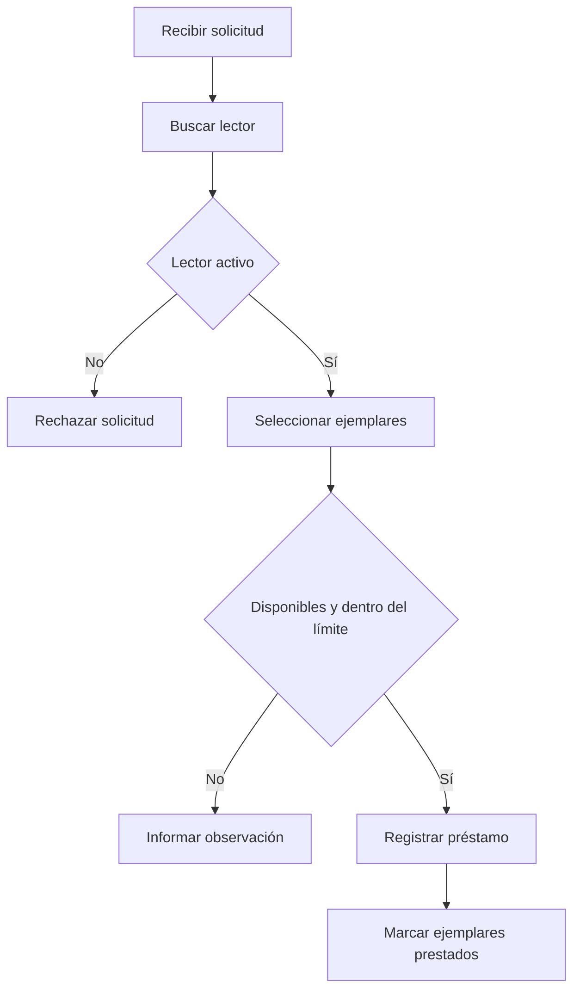
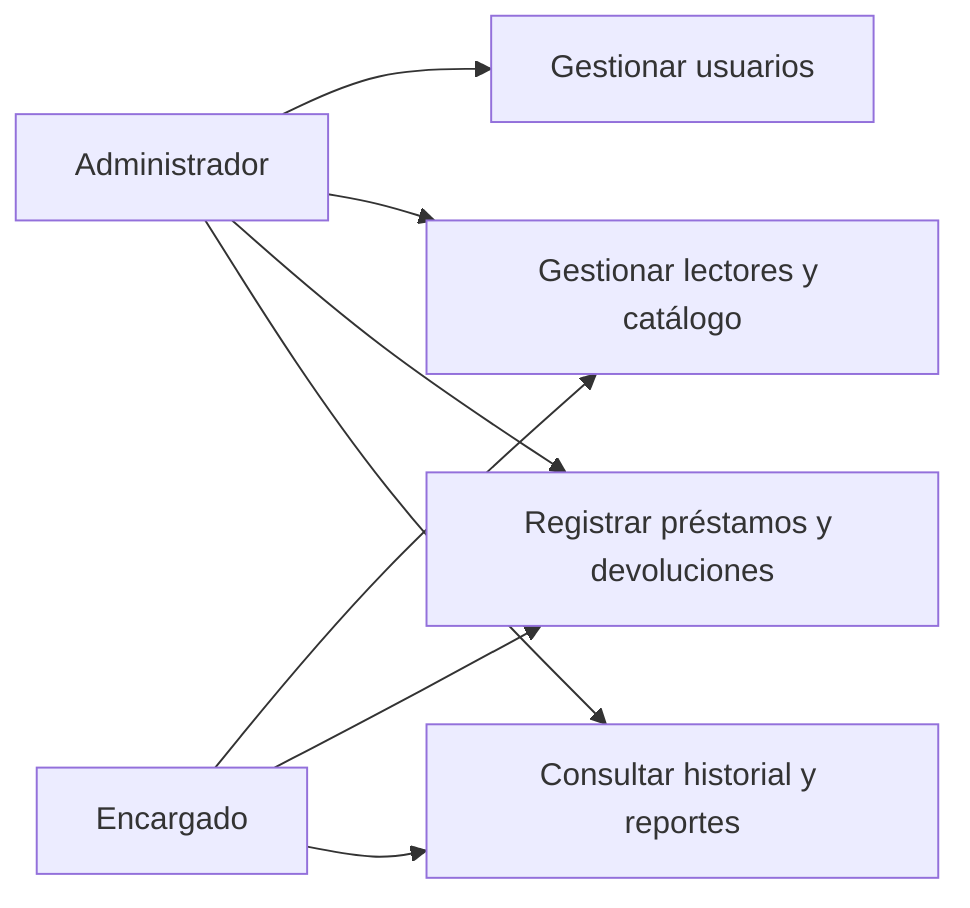
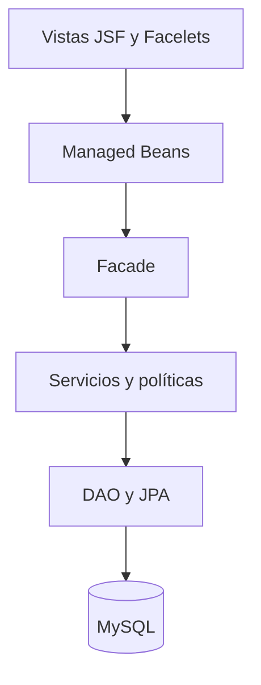
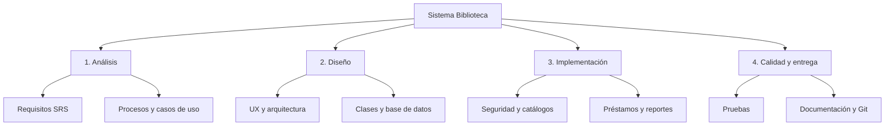
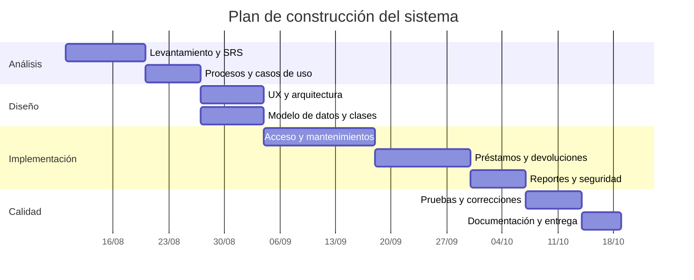
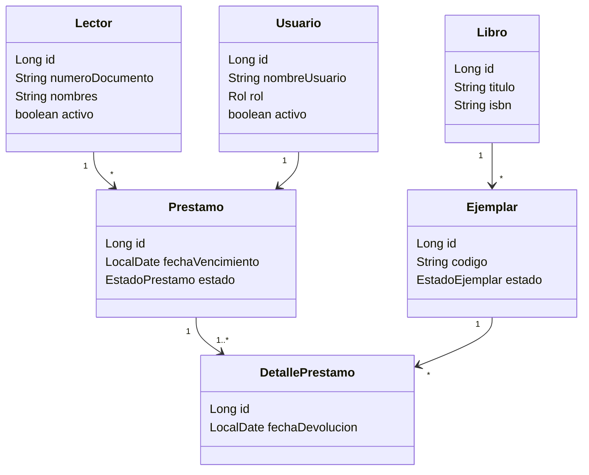
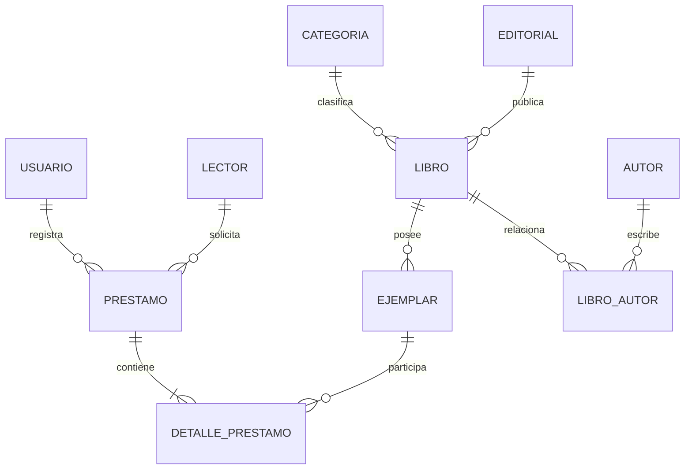

# Diagramas de la solución

## Proceso de préstamo

## Casos de uso

## Arquitectura

## Estructura de desglose del trabajo

## Cronograma referencial

## Diagrama de clases del dominio

## Modelo entidad-relación

